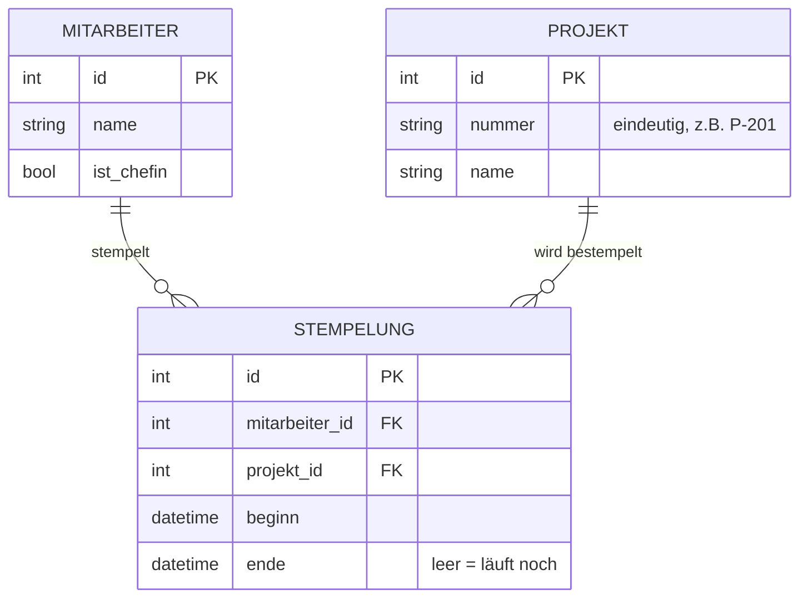

# Projektarbeit Zeiterfassung

## Ausgangslage

Eine kleine Firma mit fünf Mitarbeitenden erfasst ihre Arbeitszeit heute auf Papier. Ihr entwickelt im Team eine Web-App, mit der die Mitarbeitenden ihre Arbeitszeit auf Projekte stempeln. Die Chefin möchte sehen, wie viele Stunden auf welches Projekt gearbeitet wurden, damit sie den Kunden Rechnungen stellen kann.

## Rahmenbedingungen

| | |
|---|---|
| Teams | 2 Teams à 4 Personen. Jedes Team baut seine eigene, vollständige App. |
| Sprache | Python. Framework, Datenbank und Aufbau wählt ihr selbst (z.B. Flask, Django, FastAPI). |
| Versionsverwaltung | Ein Git-Repository pro Team, alle Mitglieder committen |
| Betrieb | Die App läuft lokal auf einem Laptop im Browser. |

Wie ihr die Arbeit im Team aufteilt, entscheidet ihr selbst. Haltet die Aufteilung fest.

## Akteure

| Akteur | Beschreibung |
|---|---|
| Mitarbeiter/in | Stempelt Arbeitszeit auf Projekte und sieht die eigenen Zeiten |
| Chefin | Verwaltet Projekte und wertet die Stunden aus |

## Use Cases

Alle Use Cases mit **Muss** müssen am Ende funktionieren. Die Use Cases mit **Kann** setzt ihr um, wenn noch Zeit bleibt.

### UC1: Projekt erfassen (Muss)

| | |
|---|---|
| Akteur | Chefin |
| Ziel | Ein neues Projekt steht zum Stempeln bereit. |
| Ablauf | 1. Die Chefin öffnet die Projektverwaltung. 2. Sie gibt Projektnummer und Name ein und speichert. 3. Das Projekt erscheint in der Liste. |
| Ausnahme | Die Projektnummer gibt es schon → Fehlermeldung, nichts wird gespeichert. |

### UC2: Einstempeln (Muss)

| | |
|---|---|
| Akteur | Mitarbeiter/in |
| Ziel | Die Arbeitszeit auf ein Projekt läuft. |
| Vorbedingung | Es gibt mindestens ein Projekt. |
| Ablauf | 1. Die Person wählt sich selbst aus (oder meldet sich an). 2. Sie wählt ein Projekt und klickt "Start". 3. Die App speichert die aktuelle Uhrzeit als Beginn. 4. Die Startseite zeigt: eingestempelt auf Projekt X seit HH:MM. |
| Ausnahme | Die Person ist schon auf ein anderes Projekt eingestempelt → die laufende Stempelung wird zur selben Uhrzeit beendet (Projektwechsel). |

### UC3: Ausstempeln (Muss)

| | |
|---|---|
| Akteur | Mitarbeiter/in |
| Ziel | Die laufende Arbeitszeit ist beendet (Pause oder Feierabend). |
| Ablauf | 1. Die Person klickt "Stopp". 2. Die App speichert die aktuelle Uhrzeit als Ende. 3. Die Startseite zeigt: nicht eingestempelt. |
| Ausnahme | Es läuft keine Stempelung → Hinweis, nichts passiert. |

### UC4: Tagesübersicht ansehen (Muss)

| | |
|---|---|
| Akteur | Mitarbeiter/in |
| Ziel | Die Person sieht, was sie heute gearbeitet hat. |
| Ablauf | 1. Die Person öffnet ihre Tagesübersicht. 2. Die App zeigt alle Stempelungen von heute mit Beginn, Ende, Projekt und Dauer. 3. Darunter steht das Total des Tages. |

### UC5: Stunden pro Projekt auswerten (Muss)

| | |
|---|---|
| Akteur | Chefin |
| Ziel | Die Chefin weiss, wie viele Stunden auf jedes Projekt gearbeitet wurden. |
| Ablauf | 1. Die Chefin öffnet die Auswertung. 2. Die App zeigt pro Projekt die Summe aller abgeschlossenen Stempelungen. |

### UC6: Pausenwarnung (Muss)

| | |
|---|---|
| Akteur | Mitarbeiter/in |
| Ziel | Die Person merkt, wenn sie zu wenig Pause gemacht hat. |
| Regel | Das Arbeitsgesetz (Art. 15 ArG) verlangt: mehr als 5½ h Arbeit → mind. 15 Min Pause, mehr als 7 h → 30 Min, mehr als 9 h → 60 Min. Eine Pause ist die Lücke zwischen zwei Stempelungen. |
| Ablauf | 1. Die Person öffnet die Tagesübersicht (UC4). 2. Reicht die Pause nicht, zeigt die App eine gut sichtbare Warnung. |

### UC7: Stempelung korrigieren (Kann)

| | |
|---|---|
| Akteur | Chefin |
| Ziel | Eine falsche Stempelung ist korrigiert, z.B. ein vergessenes Ausstempeln. |
| Ablauf | 1. Die Chefin sucht die Stempelung. 2. Sie ändert Beginn oder Ende und speichert. 3. Die Auswertung (UC5) zeigt die korrigierte Zeit. |

### UC8: Auswertung exportieren (Kann)

| | |
|---|---|
| Akteur | Chefin |
| Ziel | Die Stunden lassen sich in Excel weiterverwenden. |
| Ablauf | 1. Die Chefin klickt in der Auswertung auf "Export". 2. Die App erzeugt eine CSV-Datei mit allen Stempelungen. |

### UC9: Zeitraum wählen (Kann)

| | |
|---|---|
| Akteur | Chefin |
| Ziel | Die Auswertung zeigt nur einen bestimmten Zeitraum, z.B. einen Monat. |
| Ablauf | 1. Die Chefin gibt in der Auswertung ein Von- und ein Bis-Datum ein. 2. Die App zeigt nur Stempelungen aus diesem Zeitraum. |

### UC10: Anmelden mit Passwort (Kann)

| | |
|---|---|
| Akteur | Mitarbeiter/in, Chefin |
| Ziel | Nur berechtigte Personen kommen in die App, und nur die Chefin sieht die Verwaltung. |
| Ablauf | 1. Die Person gibt Benutzername und Passwort ein. 2. Die App zeigt die passenden Funktionen. |

Eigene Ideen sind willkommen, sprecht sie vorher mit der Lehrperson ab.

## Beispiel für ein Datenmodell

Dieses Datenmodell reicht für alle Muss-Use-Cases. Ihr dürft es übernehmen, anpassen oder ein eigenes entwerfen.

| Tabelle | Feld | Typ | Bedeutung |
|---|---|---|---|
| **Mitarbeiter** | id | Zahl | Primärschlüssel |
| | name | Text | z.B. "Anna Meier" |
| | ist_chefin | Ja/Nein | Darf Projekte verwalten und auswerten |
| **Projekt** | id | Zahl | Primärschlüssel |
| | nummer | Text, eindeutig | z.B. "P-201" |
| | name | Text | z.B. "Webshop Müller AG" |
| **Stempelung** | id | Zahl | Primärschlüssel |
| | mitarbeiter_id | Zahl | Verweis auf Mitarbeiter |
| | projekt_id | Zahl | Verweis auf Projekt |
| | beginn | Datum und Uhrzeit | Zeitpunkt des Einstempelns |
| | ende | Datum und Uhrzeit, darf leer sein | Zeitpunkt des Ausstempelns; leer, solange die Stempelung läuft |

Wichtige Überlegungen dazu:

- **Pausen werden nicht gespeichert.** Eine Pause ist die Lücke zwischen dem Ende einer Stempelung und dem Beginn der nächsten.
- **Eine laufende Stempelung** ist eine mit leerem `ende`. Pro Mitarbeiter/in darf es höchstens eine geben (UC2).
- **Die Dauer wird berechnet,** nicht gespeichert: `ende - beginn`.

Beispieldaten für einen Tag von Anna (ein Projektwechsel, eine Pause, eine laufende Stempelung):

| id | mitarbeiter_id | projekt_id | beginn | ende |
|---|---|---|---|---|
| 1 | 1 (Anna) | 2 (P-201) | 2026-10-12 08:00 | 2026-10-12 10:00 |
| 2 | 1 (Anna) | 3 (P-202) | 2026-10-12 10:00 | 2026-10-12 12:00 |
| 3 | 1 (Anna) | 2 (P-201) | 2026-10-12 12:45 | *(leer)* |

Zwischen Stempelung 2 und 3 liegt eine Pause von 45 Minuten. Zwischen 1 und 2 liegt keine Pause, das ist ein Projektwechsel.

## Technische Anforderungen

- Alle Daten werden dauerhaft gespeichert (Datenbank oder Datei). Nach einem Neustart ist nichts verloren.
- Die Pausenregel (UC6) ist mit mindestens 5 automatischen Tests geprüft.
- Ein README erklärt, wie man die App installiert und startet.

Tipps:

- Baut zuerst den einfachsten Weg durch die App und verschönert erst danach.
- Committet oft und pusht spätestens am Ende jeder Lektion.
- Arbeitet nicht alle vier an derselben Datei, sonst gibt es Konflikte.

## Präsentation

Führt alle umgesetzten Use Cases live vor und erklärt einen Code-Ausschnitt, auf den ihr stolz seid. Alle vier Teammitglieder sprechen.

## Hinweise und Ressourcen

- **Framework:** Flask ist am schnellsten gelernt, eine Datei genügt für den Anfang. Django bringt Login und eine Verwaltungsoberfläche mit, ist aber umfangreicher. Begründet eure Wahl in der Reflexion.
- **Zeit:** Rechnet mit `datetime` und `timedelta` aus der Python-Standardbibliothek.
- **Aussehen:** Ein fertiges CSS wie Pico.css macht schlichtes HTML ohne Aufwand ansprechend.
- **Hilfe:** Zuerst die Fehlermeldung lesen, dann im Team fragen, dann die Lehrperson.

Links:

- [Flask Quickstart](https://flask.palletsprojects.com/en/stable/quickstart/)
- [Django Tutorial](https://docs.djangoproject.com/de/5.2/intro/tutorial01/)
- [sqlite3 in Python](https://docs.python.org/3/library/sqlite3.html)
- [pytest: Erste Schritte](https://docs.pytest.org/en/stable/getting-started.html)
- [Pico.css](https://picocss.com/)